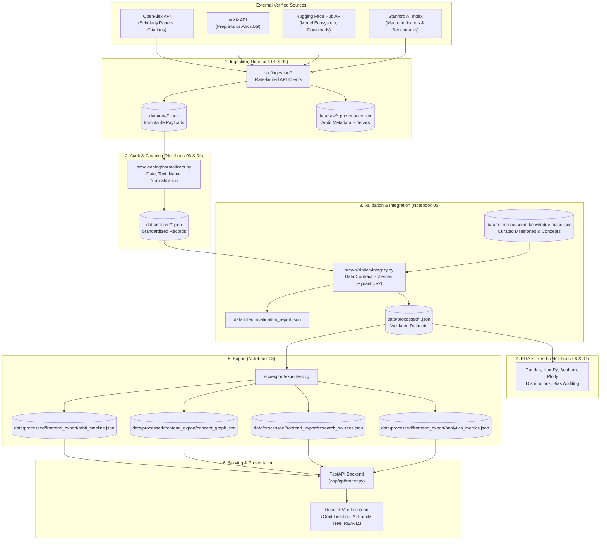

# AI Evolution Map: Architecture Specification

## 1. Architectural Philosophy

**AI Evolution Map** is an evidence-backed platform that tracks the historical milestones, scientific literature, conceptual genealogy, and empirical trends of Artificial Intelligence.

### The Jupyter-First Core Principle
Jupyter Notebook is the **primary execution environment** for:
- Data Ingestion & API interaction
- Data Quality Auditing
- Data Cleaning, Normalization & Entity Disambiguation
- Referential Integrity Validation
- Exploratory Data Analysis (EDA) & Trend Analysis
- Deterministic Frontend Exports

FastAPI and React do **not** perform data ingestion, ETL, or cleaning. FastAPI functions solely as a light distribution layer serving pre-validated, immutable artifacts generated by the notebook pipeline.

---

## 2. End-to-End Pipeline Data Flow

---

## 3. Directory and Responsibility Matrix

| Path | Primary Responsibility | Modifiable In Web Requests? |
|---|---|:---:|
| `notebooks/` | Step-by-step pipeline execution, narrative, data science exploratory workflows | No |
| `src/ingestion/` | Rate-limited, resilient HTTP clients with retry policies and exponential back-off | No |
| `src/cleaning/` | Pure transformations: date normalization, abstract reconstruction, slug creation | No |
| `src/validation/`| Referential integrity checks (endpoint existence, source existence, unique IDs) | No |
| `src/common/` | Single source of truth for Pydantic schemas, enums, and ID generation | No |
| `src/export/` | Deterministic export routines generating frontend-ready JSON, CSV, and Parquet | No |
| `data/raw/` | Read-only, immutable external payloads with provenance sidecars | No |
| `data/interim/` | Temporary cleaned datasets and validation reports | No |
| `data/processed/`| Schema-compliant datasets and versioned exports | No |
| `backend/app/` | FastAPI read-only service distributing pre-computed artifacts | Read-Only |
| `frontend/` | React/TypeScript UI (Orbit Timeline, AI Family Tree, REAVIZ charts) | Frontend Only |

---

## 4. Key Engineering Guardrails

1. **Immutability of Raw Data**: Once an API response is written to `data/raw/`, it is never modified in place.
2. **Preservation of Uncertainty**: Incomplete historical dates (e.g. 1956 Dartmouth workshop) are stored as year strings (`1956`), not coerced to fictitious timestamps like `1956-01-01`.
3. **Traceable Provenance**: Every Milestone and Relationship cites at least one valid `ResearchSource.id`. Claims lacking evidence are flagged and placed in a review state.
4. **No Premature Complexity**: No external database engines (PostgreSQL, MongoDB) are introduced until dataset volumes exceed memory or necessitate live concurrent multi-user transactions.
